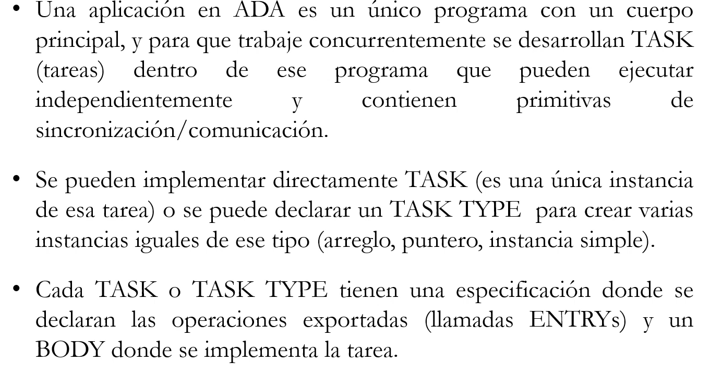

# ADA

Estado: Sin empezar
ítem principal: Exp Práctica (Exp%20Pr%C3%A1ctica%202520675b4f6f80b585c8c489c55d3cec.md)

# Lenguaje ADA (Rendezvous)



En el header se especifican los entry que tendrá esa tarea. También va a tener un body donde se implementa la tabla. Donde tendrá la opción para aceptar el pedido del entry. Si no, está diciendo que puede resolver una operación que nunca hace

## Sintaxis - estructura principal


### Especificacón de las tareas

Tareas sin entrys, con entrys sin parámetros, con entrys con parámetros


Cuando no tienen parámetros son utilizados para barreras (sincronización por condición).

La comunicación entre dos tareas es sincrónica hasta que se devuelvan los resultados, en el caso del In Out.

### Cuerpo de las tareas

```abap
TASK BODY nombreT1 IS
variables
BEGIN
implementación de la tarea
END nombreT1
```

Si hubiera definido un arreglo de 10 tareas de tipoT1, cada una de esas instancias de esas tareas del arreglo, no sabe quién es (qué pos del arreglo es). Por lo tanto, la única manera en que una tarea sepa en qué posición está, es recibiendo el valor a través de un entry. Donde esa otra tarea le diga cuál es su posición en el vector, y a partir de ahí usar ese valor como identificador propio. 

## Comunicación / Sincronización


Poner lo mínimo y necesario, porque el otro se bloquea hasta que el Accept termine.

## Entry Calls


### Condicional


### Temporal


## Accept

- Por cada entry declarado en el header de una tarea, debe haber al menos un accept para dicho entry en el cuerpo de esta.
- Para cada entry existe implícitamente una cola de pedidos (no se puede manipular)
- El **accept** puede tener un cuerpo, el cual, en caso de que se ejecute, hasta que no se termine de ejecutar el mismo no se pierde la soncronización con el entry call.
- El accept demora la tarea hasta que haya al menos un entry call en la cola implícita asociada; saca al primero de ellos y, dependiendo del tipo de accept hace:
    - Si no tiene cuerpo: termina inmediatamente y ambas tareas continúan con su ejecución
    - Si tiene cuerpo: copia los parámetros reales de llamado en los parámetros formales (si hay); ejecuta las sentencias que están en el cuerpo; cuando termina los parámetros formales de salida son copiados a los reales (si tuviese parámetros de tipo OUT o IN OUT). Luego ambas tareas continúan con su ejecución.

---

### SELECT (Wait selectivo) - guarda

ADA brinda la posibilidad de implementar wait selectivos por medio de **comunicación guardada. Select para los Accept.** Permite tener alternativas de ACCEPT que pueden o no tener asociada una condición booleana (no se pueden utilizar los parámetros del entry como parte de la condición) utilizando la clausula **when.**


---

### ELSE / OR DELAY


Generalmente en S4 es un null para no hacer nada.

---

La tarea que hace el accept puede saber cuantos pedidos hay para un entry en particular de la siguiente forma: NombreDelEntry’count. Y este atributo puede ser utilizado en los accept. **Se utiliza para manejar prioridades.** El que tiene menos prioridad, solo podrá ser aceptado, si el count del de mayor prioridad es = 0. Si no, se selecciona la otra alternativa de la guarda. 

---

---

---

## Ejercicios de ejemplo

### Ejercicio 1


---

Cambiar la solución para modelar la espera máxima de 10 minutos.


Si pasaron los 10 minutos, se saca el pedido de la cola del entry y ejecuta las sentencias del OR DELAY (en este caso no hace nada).

---

### Atender por prioridad de acuerdo al orden de llegada


---

### Ejercicio igual al anterior pero con **dos** empleados

Ahora Empleado será un tipo tarea y declaramos dos variables: EmpleadoA , EmpleadoB: empleado;

El pedido hay que hacerselo a una tarea, no a un tipo tarea. Se lo hago al empleadoA o al B. Pero el cliente no debe elegir a qué empleado ir. 


Necesitamos dos comunicaciones. El cliente le hace el pedido al Administrador, y luego espera a que un empleado le envíe la respuesta.


El programa principal puede hacer el Ident. O el mismo admin.


ADMINISTRADOR:

Para evitar tener que encolar en colas de forma explicita los pedidos de los clientes, podemos esperar hasta que haya un pedido de un empleado para aceptar el pedido del cliente. Ya que en este caso el cliente no tiene que hacer más nada que esperar el resultado, así que lo dejo esperando.


Por eso se hace el accept del pedido de un cliente dentro del accept del pedido siguiente del empleado que indica que ya hay uno disponible.

Solución final:


---


Cada tarea tiene un vector, el administrador decide qué número hay que buscar, cada una de las tareas cuenta la cantidad de veces que aparece ese numero en el vector, y se lo envía al administrador para que cuente el total entre todas las tareas.


Si hago en un sólo for el contar y el accept resultado. hago la cuenta secuencialmente, hasta que no termina una tarea, no puede mandarle a la otra el numero para que arranque a hacerlo concurrentemente.

Hay una posible demora si hay demora en unas de las tareas en el primer for. Eso se puede mejorar haciendo que el contador le pida el número al admin, en vez del admin avisarle a todos:


Por eso en este caso, el for itera hasta 2*N, porque por cada contador recibe dos pedidos, uno para saber el valor y otro para enviarle el resultado.