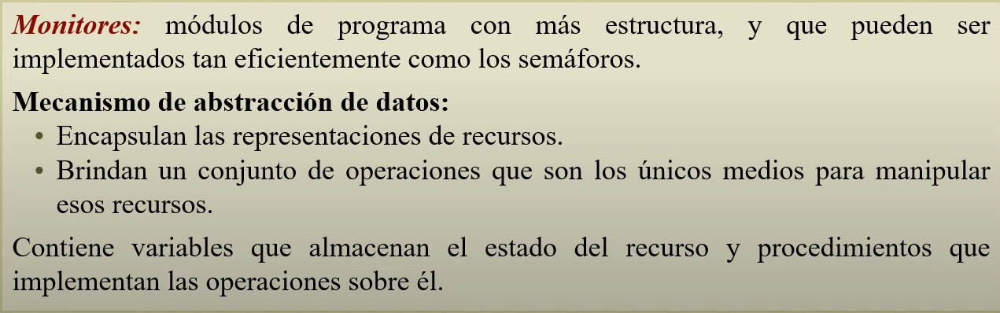

# Monitores

Estado: Sin empezar
Subítem: Ejemplos y Técnicas (Ejemplos%20y%20T%C3%A9cnicas%2026f0675b4f6f80d5a847dd13b648dcd7.md)
ítem principal: Exp Práctica (Exp%20Pr%C3%A1ctica%202520675b4f6f80b585c8c489c55d3cec.md)

Representan a los recursos compartidos, deja de haber variables compartidas.

Se libera la exclusión mutua, ya que se asegura implícitamente. Los procesos en el mismo monitor no ejecutan concurrentemente (no coexisten 2 procesos al mismo tiempo en el monitor)

Sincronización por Condición sí hay que expresarla, para dormir procesos y liberar el monitor dejando que otro proceso continúe con un procedimiento.

Hasta que el código de inicialización no termine, no acepta llamados a procedimientos. 

### Ejemplo de uso de monitores

## Ejemplo Productor/Consumidor

Operaciones para usar en la práctica para la sincronización por condición usando el tipo *cond*

Las op. adicionales son sólo para la teoría, no para la práctica

---

Así es en la práctica para evitar los conflictos de acceso cuando se despierta a un proceso y justo llega otro. Para controlar el acceso en orden al Cajero