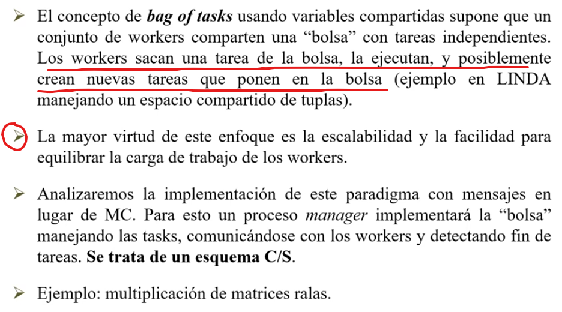

# Paradigmas

Estado: Sin empezar
ítem principal: Teorías PC (Teor%C3%ADas%20PC%202520675b4f6f80a7b401ea2c307583f0.md)

# Paradigmas para la interacción entre procesos

## Manager/Worker



## Heartbeat


### Topología de una red


Tenemos que determinar la cantidad de iteraciones que hace cada uno de los procesos. Si tuviesemos la información del diámetro de la red (distancia máxima entre dos nodos) entonces podríamos utilizarlo para hacer esa cantidad de iteraciones (para llegar de un extremo al otro).

Cada nodo debe recorrer un n° de rondas para conocer la topología completa. Como dijimos, si el Diámetro D de la red es conocido se resuelve con el siguiente algoritmo:

```java
chan topologia[1:n] ([1:n,1:n] bool)

Process Nodo[o:1..n]{
	bool vecinos[1:n], //indica si el proceso es o no vecino de los otros procesos, sirve para saber con quién me tengo que comunicar
	bool nuevaTop[1:n,1:n], top[1:n,1:n] = ([n*n] false); //matriz topologia que el proceso p conoce hasta el momento, inicializado en false
	
	top[p,1..n]=vecinos; //a la fila p le asigna quienes son sus vecinos
	
	for(r=0; r<D; r++){
		// A cada uno de mis vecinos directos le envio lo que yo tengo como topologia (resul parcial)
		for [q=1 to n st vecinos[q]] send topologia[q](top)
		// Recibo de mis vecinos, una nueva topología, actualiza su top
		for [q=1 to n st vecinos[q]]{
			receive topologia[p](nuevatop);
			top = top or nuevatop; //hace or entre cada campo de las matrices, y de esa forma si en nuevaTop es true y en top era falso, ahora es true
		}
	} 
}
```

El problema es que rara vez se conoce el valor del diámetro D. Y además, hay un excesivo intercambio de mensajes innecesario para los procesos cercanos al “centro” que conocen la topología más pronto y no aprenden nada nuevo.

**Lo ideal es que cada nodo pueda de forma local darse cuenta si llegó al resultado final o no.**

> Para esto, sabemos que todos los nodos están conectados a al menos otro nodo. Entonces, para saber si ya conozco toda la topología, es necesario saber que en cada fila de la matriz, tendré al menos un true. Si la fila X tiene todos falsos, significa que todavía no recibí la información del nodo X.
> 

Al tener la información de todos los nodos, resta la última comunicación con los vecinos directos al nodo, para avisar que ya conozco todo y no me envíen nunca más nada y no esperen recibir nada de mí.

Y a su vez, le estoy dando la información completa al nodo vecino, entonces en esa iteración ya conocerán la topología completa, y repiten el proceso del último aviso.

No siempre la terminación se puede determinar localmente (o sea, de esta manera que explicamos anteriormente)

```java
chan topologia[1:n](emisor:int; listo:bool; top:[1:n;1:n]bool)

Process Nodo[p:1:n]{
	bool vecinos[1:n], 
			 activo[1:n]=vecinos,
			 top[1:n,1:n]=([n*n]false),
			 nuevatop([1:n,1:n]);
	bool qlisto, listo=false;
	int emisor;
	
	top[p,1:n]=vecinos
	
	while(not listo){
		for[q=1 to n st activo[q]] send topologia[q](p,false,top);
		for [q=! to n st activo[q]]{
			receive topologia[p](emisor,qlisto,nuevatop);
			top=top or nuevatop;
			if(qlisto) activo[emisor]=false;
		}
		if (todas las filas de top tiene 1 entry true) listo=true;
	}
	for[q=1 to n st activo[q]] send topologia[q](p,listo,top)
	//cuando termine recibo esto pero lo descarto porque ya terminé, pero para que no haya mensajes dando vueltas "Ignorados"
	for[q=1 to n st activo[q]] receive topologia[p](emisor,d,nuevatop);
}
```

---

## Pipeline


## Probe-Echo


## Broadcast


## Token Passing


## Servidores Replicados

