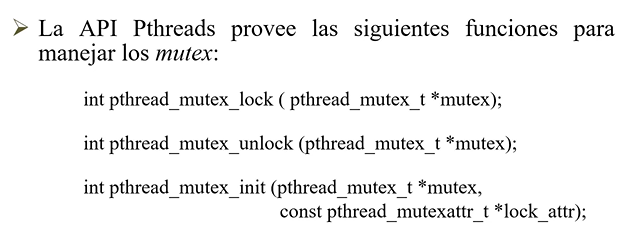

# Pthreads

Estado: Sin empezar
ítem principal: Teorías PC (Teor%C3%ADas%20PC%202520675b4f6f80a7b401ea2c307583f0.md)

POSIX, biblioteca en C para multithreading (Pthreads). Para creaer threads, asignarles atributos, darlos por terminados, identificarlos, etc.

Es un estándar para el manejo de hilos. Concepto a tener en cuenta: **funciones reentrantes.**

```c
#include <pthread.h>

int pthread_create (pthread t *thread_handle, 
	const pthread_attr_t *attribute, 
		void * (thread_function)(void *), 
			void *arg);

int pthread_exit(void *res);

int pthread_join(pthread_t thread, void **ptr); // 

int pthread_cancel(pthread_t pthread);

//El main debe esperar a q todos los threads terminen
```

**pthread_create:** Sirve para crear un hilo. 

- Parámetros:
    - Manejador (1er parámetro)
    - Atributos (seg parámetro, x default)
    - Función a ejecutar por el hilo (tercer parámetro)
    - Todos los parámetros que necesita esa función para ejecutarse (cuarto parámetro).

**pthread_exit:** Sirve para que un hilo indique que terminó y pueda devolver un resultado. Esta se llama al final de la funcion pasada por parametro en el create.

**pthread_join: Sirve p**ara esperar a que el hilo que pasamos como primer parámetro haya terminado su ejecución, y en caso deque ese hilo en particular haya devuelto algo, el valor lo devolvería en el sgundo parámetro de la función join

**pthread_cancel:** Solicitar que un hilo se cancele. Después hay que ver si el SO lo hace y en qué momento.

*Toda variable que está declarada en el cuerpo del hilo principal puede ser accedida por los distintos hilos que fueron creados dentro de ese cuerpo.*

**mutex:** Se inicializa automáticamente en desbloqueada. 

Tiene dos estados:

- locked
- unlocked

Lock es una operación atómica.



La tercera es la inicialización de una var mutex para poder utilizarla. Le pasa como segundo parámetro una serie de atributos (valores por default). El tipo de mutex debemos definir las distintas soluciones.

---

## Productores/Consumidores con exclusión mutua

```c
pthread_mutex_t mutex;
int hayElemento;
tipo_elemento Buffer;
...
main(){
	hayElemento=0;
	pthread_init();
	pthread_mutex_init(&mutex, NULL);
	
	/* Create y join de threads productores y consumidores*/
	
	
}

void *productor (void *datos){
	tipo_elemento elem;
	int ok; // indica si pudimos operar o seguir intentando con el mimso dato
	...
	while (true){
		ok = 0;
		generar_elemento(&elem);
		while (ok==0){
			pthread_mutex_lock(&mutex);
			if (hayElemento==0){
				Buffer = elem;
				hayElemento = 1;
				ok = 1;
			}
			pthread_mutex_unlock(&mutex);
		}
	}
}

void *consumidor(void *datos){
	int ok;
	tipo_elemento elem;
	...
	while (true){
		ok = 0;
		while (ok == 0){
			pthread_mutex_lock(&mutex);
			if (hayElemento == 1){
				elem = Buffer;
				hayElemento = 0;
				ok = 1; //se pudo tomar el elem, para salir del while más interno y procesar el dato que ha consumido
			}
			pthread_mutex_unlock(&mutex);
		}// fin while ok == 0;
		procesar_elemento(elem)
	} // fin while true
}
```

---


Algunos permiten el bloqueo recursivo (bloquear x, y dentro de la SC, volver a bloquear x) y otros que no.

---

Para evitar la espera osciosa de la SC, hay una tercer función que permite: si la variable mutex está desbloqueada, la bloqueo. Si está bloqueada, no duerme el thread, si no que le permite seguir. Esta función es: pthread_mutex_trylock(pthread_mutex_t *mutex_lock). Retorna el control informando si pudo hacer o no el lock.

---

## Variables Condición

Podemos utilizar variables de condición para que un thread se autobloquee hasta que se alcance un estado determinado del programa.

Cada var de cond. estará asociada con un predicado. Cuando el predicado se convierte en verdadero (TRUE) la variable de condición da una señal para el/los threads que están esperando por el cambio de estado de la condición.

Siempre tienen un mutex asociada a ella. Cada thread bloquea este mutex y testea el predicado definido sobre la variable compartida. 

Si el predicado es falso, el thread espera en la variable condición utilizando la función pthread_cond_wait (NO USA CPU).


**pthread_cond_wait:** Desbloquea la variable mutex pasada como parámetro, luego, duerme el proceso. Cuando alguien lo despierta, antes de salir de la función wait, tiene que volver a adquirir el acceso a la SC bloqueando la variable mutex que pasamos como segundo parámetro. **Esto sucede internamente.**

**pthread_cond_timedwait:** Se le pasa un tercer parámetro como tiempo de espera.

**signal y broadcast:** son para despertar a un determinado proceso. Signal despierta al primero que estaba dormido, y broadcast, despierta a todos los procesos dormidos en la variable condición

```c
pthread_cond_t vacio, lleno;
pthread_mutex_t mutex;
int hayElemento;
tipo_elemento Buffer;
...
main{
	hayElemento=0;
	pthread_init();
	pthread_cond_init(&vacio, NULL);
	pthread_cond_init(&lleno, NULL);
	pthread_mutex_init(&mutex, NULL);
	// ...init de distinos hilos para prod y cons
}

void *productor(void *datos){
	tipo_elem elem;
	while(true){
		generar_elemento(elem);
		pthread_mutex_lock(&mutex);
		while (hayElemento == 1){ //mismo problema de competencia de acceso con monitores
			pthread_cond_wait(&vacio, &mutex);
		}
		Buffer = elem;
		hayElemento = 1;
		pthread_cond_signal(&lleno);
		pthread_mutex_unlock(&mutex);
	}
}

void *consumidor(void *datos){
	tipo_elem elem;
	while(true){
		pthread_mutex_lock(&mutex);
		while (hayElemento == 0){
			pthread_cond_wait(&lleno,&mutex);
		}
		elem = Buffer;
		hayElemento = 0;
		pthread_cond_signal(&vacio);
		pthread_mutex_unlock(&mutex);
		procesar_elemento(elem);
	}
}
```

---


### Atributos para Threads


No nos van a interesar manejar en este momento.


---

## Semáforos (librería semaphore.h)

### Declaración y operaciones

**sem_init (&semaforo, alcance, inicial)** → Inicial es el valor con que se inicializa el sem. Alcance indica si es compartido por los hilos de un único proceso (0) o por los de todos los procesos ( =! 0)

**sem_wait(&semaforo) →** Equivale al P.

**sem_post(&semaforo) →** Equivale al V.

Existen funciones extra para: wait condicional, obtener el valor de un semáforo y destruir un semáforo (QUE NO VAMOS A USAR EN LA PRÁCTICA).

**PRODUCTOR/CONSUMIDOR**

<aside>
〰️

Las funciones de Productor y Consumidor serán ejecutadas por threads independientes. Accederán a un buffer compartido (datos), donde el productor deopsita una secuencia de enteros de ***1*** a ***numItems*** en el buffer***.*** El consumidor busca estos valores y los suma. Los semáforos **vació** y **lleno** garantizan el acceso alternativo de productor y consumidor sobre el buffer

</aside>

```c
//Encabezado del programa
#include <pthread.h>
#include <semaphore.h>
#define SHARED 1

void *Productor(void *);
void *Consumidor(void *);

sem_t vacio,lleno;
int dato,numItems;

int main(int argc, char* argv[]){
	
	sem_init(&vacio, SHARED, 1); // Se alternan el uso de esta manera
	sem_init(&lleno, SHARED, 0); // Con dos semáforos
	//Creamos dos hilos para ejecutar las funciones
	pthread_create(&pid,&attr, Productor, NULL);
	pthread_create(&cid,&attr, Consumidor, NULL);
	
	//Esperamos a que terminen ambos
	pthread_join(pid,NULL);
	pthread_join(cid,NULL);
}

void *Productor(void *arg){
	int item;
	for (item = 1; item<=numItems; item++){
		sem_wait(&vacio);
		dato = item;
		sem_post(&lleno);
	}
	pthreads_exit();
}

void *Consumidor (void *arg){
	int total= 0,item,aux;
	for (item=1; item<=numItems; item++){
		sem_wait(&lleno);
		aux=dato;
		sem_post(&vacio);
		total=total+aux;
	}
	printf("TOTAL: %d\n", total);
	pthreads_exit();
}
```

---

## Monitores


En cada arreglo vamos a tener los manejadores de los hilos correspondientes para los L lectores y E escritores.

Inicializamos el sistema, las dos variables condición y creamos los E hilos para los escritores que van a ejecutar la función Escritor y los L hilos que ejecutan la función Lector.

Por cada monitor que tengamos, tenemos que tener una mutex que permita manejar a mano el acceso exclusivo a ellos


El código es el mismo, sólo cambia la forma de despertar a todos y los signal.