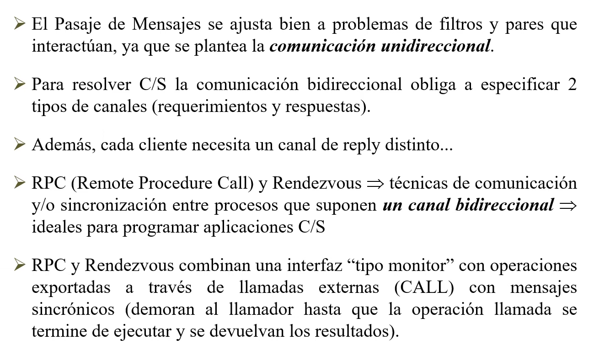

# RPC

Estado: Sin empezar
ítem principal: Teorías PC (Teor%C3%ADas%20PC%202520675b4f6f80a7b401ea2c307583f0.md)

## Conceptos básicos

Comunicación sincrónica y bidireccional. Envía un pedido y se demora esperando el resultado, en el mismo canal (bidireccional).

La diferencia entre RPC y Rendezvous. Combinan una interfaz tipo monitor

En RPC tendremos módulos, que exportan procedimientos, y por otro lado tendremos procesos que podrán llamar a procedimientos de estos módulos. Cada vez que se atiende un pedido de un procedimiento, **se genera un nuevo proceso** que va a vivir y servir nada más que para **atender la invocación a ese procedimiento**, **devuelve los resultados al que hizo el llamado y termina su vida. JAVA utiliza esta herramienta**

En rendezvous, son procesos iguales continuamente trabajando, cuando uno tenga que hacer un pedido, se lo hace a quien sabe resolverlo, ese proceso tendrá una sentencia de Entrada que dice, en este momento voy a atender una llamada a una operación, la resuelve, devuelve los parámetros, y luego ambos continúan su trabajo. **Ada utiliza esta herramienta**

---

## Remote Procedure Call (RPC)

Sólo veremos teoría

Básicamente utiliza las herramientas que ya vimos

