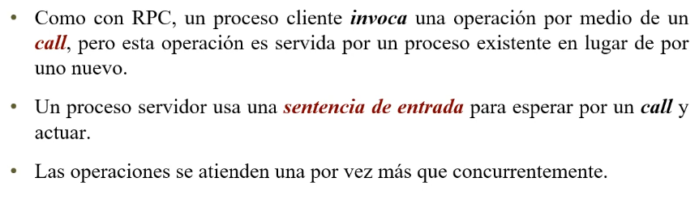

# Rendezvous

Estado: Sin empezar
ítem principal: Teorías PC (Teor%C3%ADas%20PC%202520675b4f6f80a7b401ea2c307583f0.md)

# Combinación de sincronización y comunicación



Los módulos son básicamente procesos. Tienen una especificación en los headers de las operaciones exportadas.


La sentencia de entrada demora al proceso server hasta que haya al menos un llamado pendiende de opname; luego elige el llamado pendiente más viejo, copia los argumentos en los parámetros formales, ejecuta S y finalmente retorna los parámetros de resultado al llamador. Luego, ambos procesos pueden continuar


Operación con parámetros correspondientes, expresión booleana si el proceso está en condiciones o no de atender ese pedido, y puede tener una expresión de scheduling que permite reordenar los llamados a esa expresión en particular (que debe hacer referencia a uno de los parámetros de entrada, y la condición booleana también puede hacer referencia a esos parámetros de la operación).

- Cuando se llega a la condición guardada, se evalúan todas las condiciones. De las que son verdaderas, tenemos que ver si hay llamados pendientes. Y si hay 1 o más que cumplen, se elige una de forma no determinística. Se atiende el llamado a la operación seleccionada, ejecutando las sentencias S, copiamos los resultados en los parámetros de salida y se devuelve el resultado. El in funciona como el if de las guardas, no vuelve a iterar. Para eso tendremos que ponerlo dentro de una estructura de control de iteración.
- Si todas las cond son falsas, no ejecuta nada y sale.
- Si no hay exitosas, pero no todas fallan, espera dentro del in hasta que alguna tenga éxito.

---

### Buffer limitado

```cpp
module BufferLimitado
	op depositar (typeT), retirar(OUT tupeT);
	
body
	process Buffer{
		queue buf;
		int cantidad=0;
		
		while (true){
			in depositar (item) and cantidad < n -> push(buf,item;
																							cantidad++;
			. retirar (OUT item) and cantidad > 0 -> pop(buf, item);
																							 cantidad--;
			ni
		 }
	}	
end BufferLimitado
```

### Filósofos Centralizado


---

# Lenguaje ADA


## Call: Entry Call

Declaración de entry simples y familida de entry.


Si el proceso no quisiera esperar al llamado, puede usar el ***Entry call condicional.*** El conjunto de sentencias adicionales sería lo que se ejecutaría si fuera atendido inmediatamente. 

El else es por si no puede ser atendido inmediatamente y necesita seguir ejecutando sentencias. De una u otra manera, el select termina sin importar por donde vaya.

Ahora..

El ***Entry call temporal*** hace que pueda esperar un cierto tiempo hasta ser atendido, si ese tiempo pasa y no lo atienden, cancela el entry call y pasa a las otras sentencias.

*Cuando se cancela el entry call, en ambos casos, automáticamente se cancela y desaparece el rastro del pedido del llamado.*

---

**El in ni, es accept**


**PARA EL EXAMEN:**

- **El accept puede no necesitar parámetros, o podría no tener cuerpo (simulando ser una barrera). Es importante marcar cuál es el cuerpo del accept, porque los parámetros formales únicamente pueden ser utilizados en el cuerpo de este. Por otro lado, hasta que no se ejecuta todo el cuerpo del accept, no se libera a la tarea que llamó a esta.**

*Tener cuidado con generar deadlock llamando tareas entre dos procesos, donde uno de ellos llama a una tarea, se bloquea para esperar el resultado, y la tarea llama a otra tarea dentro del proceso demorado.*

- Las sentencias son independientes del accept, se llevan a cabo si este es ejecutado

*else:* Si esta tarea no puede atender, hago otra cosa (conjunto sentencias debajo del else)

*delay*: Esperar un tiempo y si no pude atender, recién ahí ejecuto las sentencias debajo del or delay

Atributos de los entry: 

- **count:** Cuántos pedidos pendientes hay en ese momento para un entry en particular.

***Cada una de las alternativas debe ser un accept. Puede haber un entry call dentro de las sentencias adicionales, o dentro del cuerpo de alguno de los accept.***

---

## Buffer de tamaño 1

```cpp
TASK TYPE Mailbox IS
	ENTRY Depositar (msg: IN mensaje);
	ENTRY Retirar (msg: OUT mensaje);
END Mailbox;

A,B,C : Mailbox; //variables tipo mailbox

TASK BODY Mailbox IS
	dato:mensaje;
BEGIN
	LOOP //while true
		
		ACCEPT Depositar (msg: IN mensaje) DO 
			dato := msg; 
		END Depositar;
		
		ACCEPT Retirar(msg: OUT mensaje) DO 
			msg := dato; 
		END Retirar;	
		
	END LOOP;

END Mailbox;

```


---


### Explicación conceptual general

| Componente | Rol |
| --- | --- |
| **Sched** | Es el *monitor activo* del sistema: recibe todas las solicitudes de lectura/escritura y decide quién entra. |
| **Lector** | Pide permiso para leer (`InicioLeer`), realiza su lectura, y luego avisa que terminó (`FinLeer`). |
| **Escritor** | Pide permiso para escribir (`InicioEscribir`), escribe, y luego avisa que terminó (`FinEscribir`). |
| **`InicioEscribir'Count`** | Es una propiedad de Ada que indica cuántas tareas están esperando en esa *entry* (control de prioridad). |
| **`Select`** | Estructura de elección que atiende la primera condición disponible (como un `if` concurrente). |
| **`accept`** | Punto de *rendezvous*: sincroniza al Scheduler con el lector o escritor que hizo la llamada. |
|  |  |

---

